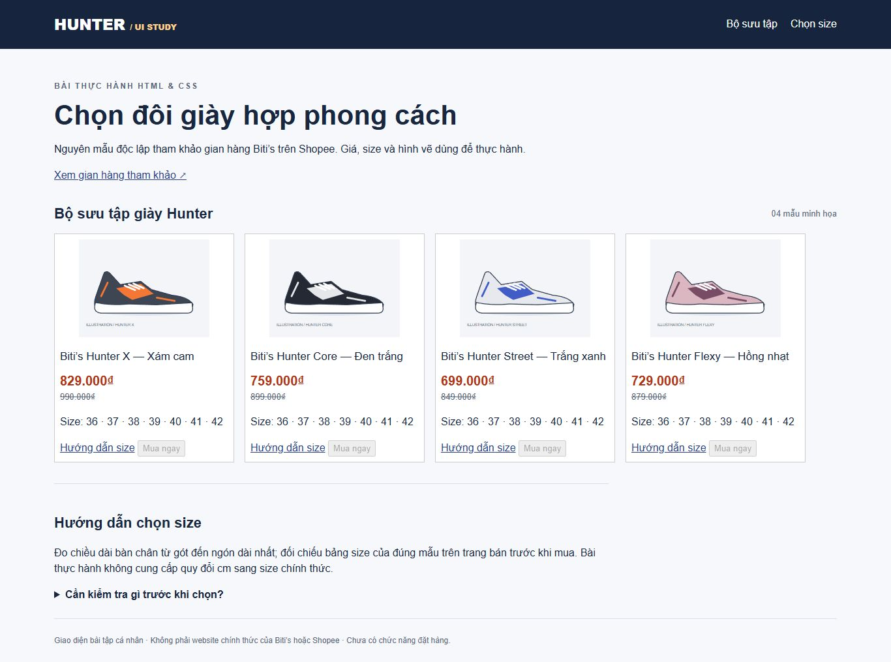
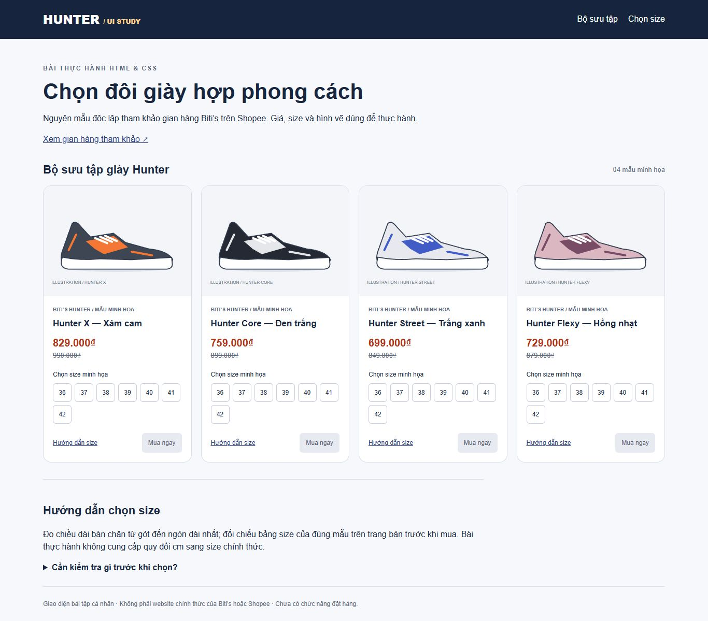

# Hunter Shoes UI

Bài tập cá nhân Buổi 1 và 2 — giao diện thẻ giày Biti’s Hunter tham khảo gian hàng [BITI’S OFFICIAL STORE trên Shopee](https://shopee.vn/bitisvn).

## Sản phẩm
Bản hiện tại là Buổi 2: bốn thẻ giày, chọn size bằng radio, hướng dẫn size bằng details, HTML ngữ nghĩa, CSS ngoài, Box Model, Flexbox, Grid responsive 4/2/1 cột, hover và focus.
Giá, màu, size giả lập; SVG tự vẽ. Chưa có giỏ hàng, backend hoặc thanh toán. Nút mua bị vô hiệu hóa.

## Cách chạy
Tải repository và mở `index.html` bằng Chrome. Mở `Buoi1/index.html` để đối chiếu bản nền. Không cần cài đặt.

## Nối tiếp hai buổi
Commit đầu lưu bản nền Buổi 1; commit kế tiếp hoàn thiện Buổi 2 trên cùng repo. Thư mục Buoi1 giữ snapshot nền. Buổi 1 được dựng lại trong phiên hỗ trợ, không khẳng định đã nộp trước đây.

## Thay đổi chính
- Sửa tràn ngang ở768px/390px bằng Grid thay hàng Flexbox cố định.
- Giữ tỷ lệ ảnh4:3 bằng contain.
- Dùng article, h3, fieldset, legend và nhóm radio riêng cho từng giày.
- Căn nhóm size/thao tác bằng Flexbox; phản hồi checked và focus-visible.

## Minh chứng

Xem [báo cáo kiểm thử](TEST_REPORT.md), [kết quả đo](evidence/results.json), [nhật ký AI](AI_USAGE.md) và [đối chiếu bài nộp](KIEM_TRA_BAI_NOP.md).

## GitHub
Repository công khai: https://github.com/hungngoquoc-7772dotcom/hunter-shoes-ui
Chưa triển khai Pages.

## Phần sinh viên tự thực hiện
Bước 8 đã thực hiện chỉnh sửa có Codex hỗ trợ: tăng ô size từ 36×36px lên 44×44px. Kiểm tra 1366/768/390/320px không tràn; mọi ô size nằm trong thẻ. Bàn phím Space, ArrowRight, Tab và hướng dẫn size đã chạy thử. Sinh viên cần hiểu và giải thích thao tác; không ghi chỉnh sửa có AI hỗ trợ là thao tác tự làm không có AI.

Ảnh README thể hiện bản Buổi 2 trước chỉnh sửa kích thước ô size tại Bước 8.
